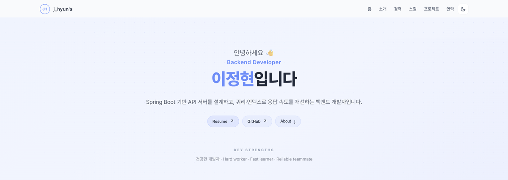
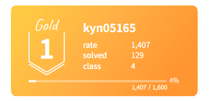

<h1 align="center">안녕하세요, 이정현입니다 👋</h1>

  실시간 서비스를 설계하고, 쿼리·인덱스로 응답 속도를 개선하는 백엔드 개발자입니다 🚀 
  <a href="https://jhyungit.github.io/">🌐 포트폴리오</a> ·
  <a href="https://yorr.site">🎮 YORR 라이브</a> ·
  <a href="https://tripcrew.duckdns.org">🧳 TripCrew 라이브</a>

  
  
  
  
  

  

---

## 🧑‍💻 About Me

Spring Boot 기반 API 서버를 설계하고, 막히면 실행계획(`EXPLAIN`)이나 네트워크 요청 단위까지 직접 파고들어 원인을 확인하고 수치로 검증합니다.
실시간 통신 규격 설계와 DB 조회 성능 최적화를 주로 다루며, Python 기반 데이터 분석에서 출발한 이력이 있어 데이터 파이프라인 구축 경험도 함께 갖추고 있습니다.

| 항목 | 내용 |
|:---|:---|
| 🎓&nbsp;**학력** | 명지대학교 정보통신공학과 졸업 (2022.02) |
| 🏫&nbsp;**교육** | SSAFY 15기 Java 전공반 (11반 반장) · T-academy 빅데이터 분석가 과정 수료 |
| 💼&nbsp;**경험** | IBK기업은행 IT금융개발부 청년인턴 · 달리셔스 기업연계 프로젝트 |
| 🌏&nbsp;**해외** | 호주 워킹홀리데이 11개월 · ILSC Sydney 어학연수 17주 (Intermediate → Advanced 수료, 우수 학생 선정) |
| 🛠&nbsp;**강점** | 실시간 통신 규격 설계 · DB 조회 성능 최적화 · AI 도구 기반 개발 워크플로 |
| 📜&nbsp;**자격** | 정보처리기사 (2024.12) · SQLD (2025.12) · ADsP (2026.11) · OPIc IH (2025.06) |

---

## 🏆 Awards

| 시기 | 수상 | 주관 |
|:---|:---|:---|
| **2026.08** | **SSAFY 2학기 공통 PJT 우수상 (1등)**  실시간 웹 파티게임 YORR · 6인 팀 팀장/PM | 삼성전자 · 고용노동부 |
| **2026.06** | **SSAFY 1학기 관통 PJT 우수상 (2등)**  여행 협업 플랫폼 EnjoyTrip · 2인 팀 팀장/백엔드 | 삼성전자 · 고용노동부 |
| **2023.09** | **IBK기업은행 청년인턴 우수인턴**  IT본부장 참석 최종 발표 · 4개 앱 통합 슈퍼앱 프로토타입 | IBK기업은행 |
| **2023.03** | **ASAC 빅데이터 분석가 과정 우수상 (1등)**  메뉴 추천 시스템 · 6인 팀 CB 모델 담당 | SK planet |

---

## 🔧 Tech Stack

| 분류 | 기술 |
|:---|:---|
| **Language** |    |
| **Backend** |      |
| **Database** |   |
| **Realtime** |    |
| **Infra** |   |
| **Data & ML** |    |
| **Frontend** |   |
| **AI·협업** |      |

---

## 📌 Main Projects

### 🎮 YORR | 스마트폰 센서 기반 실시간 웹 파티게임
> 앱 설치·회원가입 없이 폰이 컨트롤러가 되는 파티게임 · 6인 팀 **PM/팀장** · **SSAFY 2학기 공통 PJT 우수상 (1등)** · **실서비스 운영**

- **WebSocket 이벤트 프로토콜 설계**: `sys`·`room`·`dice`·`reaction`·`voice` 전 이벤트의 envelope·payload 스키마 **28종을 단독 정의**하고 프론트 미러 타입까지 동기화. 규격을 선확정한 덕에 게임 3종 확장 시 페이로드 추가만으로 대응
- **지연 ↔ 공정성 트레이드오프**: 센서 값 전량 전송은 그 자체가 지연이 되므로 동작 판정은 클라이언트에 두고, 조작 가능한 클라이언트를 신뢰하지 않도록 상태·순서·점수의 권한은 서버에 유지
- **버그를 화면이 아니라 계약 단위로 해결**: 세션↔playerId 매핑과 세션 만료(`SESSION_EXPIRED`) 구분 처리로 대기실 연결 화면 멈춤 버그 해결. 관전 화면이 조작보다 먼저 결과를 노출하던 문제는 `shake`/`shaken` 이벤트 계약을 신설해 동일 유형의 순서 역전을 구조적으로 차단
- **WebRTC 풀메시 음성 채팅**: BE ICE 시그널링부터 FE `voiceMesh`까지 전 구간 구현, coturn TURN 연동 및 CORS·에코 문제 수정
- **AI 개발 워크플로 구성**: `CLAUDE.md`·`CONTRIBUTING.md`에 코딩 규칙과 커밋·MR 컨벤션을 고정해 6인 팀의 생성 결과 편차를 줄이고, MCP로 Jira·Notion을 연동해 티켓 발급·스프린트 운영·문서화를 자동화. 생성된 결과는 커밋 단위로 직접 확인한 뒤 반영
- **운영 성과**: 2회 배포(7/30·8/5) — **최고 동시접속 80명 · 누적 참여 635건 · 487판** · 만족도 설문(n=17) 4점 이상 94.1%
- 개인 프로젝트 [yorr-arcade](https://github.com/jhyungit/yorr-arcade)에서 1인 개발한 게임 2종이 **최종 라인업 3종 중 2종으로 채택** (팀 서비스로의 이식은 팀원 담당)
- **기술 스택**: Java 21, Spring Boot, Spring Data JPA, WebSocket, WebRTC, Redis, MySQL, React, TypeScript, Docker, AWS EC2

🔗 [Live](https://yorr.site) · [GitHub Repository](https://github.com/team-yorr/yorr)

---

### 🧳 TripCrew | 여행 계획 협업 플랫폼
> Spring Boot 기반 협업 서비스 · 2인 팀 **팀장/백엔드** · **SSAFY 1학기 관통 PJT 우수상 (2등)** · AWS 배포 운영 중 (상장상 명칭 EnjoyTrip)

- **조회 성능 최적화**: 관리자 회원 조회를 전체 로드 → 서버 페이징 + `(role, created_at)` 복합 인덱스로 개선. 30만 건 기준 **응답 0.473초 → 0.018초 (약 26배)**, `EXPLAIN`으로 `type: ALL → ref` 전환과 filesort 제거 검증
- **개선 이후의 한계까지 실측**: 인덱스 적용 후에도 `OFFSET 100000` 구간은 0.244초로 저하되는 것을 확인해, 대용량 페이징의 근본 해법이 커서 방식임을 수치로 확인
- **동시 수정 충돌 처리**: 여행 계획 공동 편집에 낙관적 락(version 컬럼) 적용 → 동시 수정 충돌 시 409 응답 후 사용자가 두 수정본 중 골라 반영하는 화면까지 구현. 충돌이 드문 특성상 비관적 락 대비 성능이 유리하다 판단
- **인증/실시간**: JWT + Refresh Token 인증, Kakao/Naver 소셜 로그인(OAuth 2.0), WebSocket(STOMP) 기반 실시간 공동 편집
- **인프라**: Docker Compose 4컨테이너(MySQL·Redis·Backend·Caddy), AWS EC2 배포, Flyway DB 버전 관리(V1~V17)
- **기술 스택**: Java 17, Spring Boot 3, Spring Security, MyBatis, MySQL 8, Redis, Vue 3

🔗 [Live](https://tripcrew.duckdns.org) · [GitHub Repository](https://github.com/tripcrew/tripcrew)

---

### 🕹️ YORR Arcade | 휴대폰을 컨트롤러로 쓰는 웹 미니게임 모음
> 개인 프로젝트 · **1인 개발** · 게임 5종 · **2종이 팀 서비스 YORR에 채택**

- **Node.js·Express·Socket.IO 실시간 서버 구현**: 방 관리와 이벤트 중계를 직접 설계하고, 클라이언트와의 통신 규약을 정의
- **휴대폰 센서를 게임 입력으로**: DeviceMotion 가속도 **14m/s²** 임계로 스윙 감지(중력 저역통과 제거 + 히스테리시스), DeviceOrientation으로 조준
- **주사위 강체 물리 직접 구현**: 미리 굴려 눈을 재배치하고 되감는 방식으로 결과 스냅 제거. **500판 시뮬레이션**으로 감쇠를 조정해 구르는 시간 1.08초 → 1.52초
- **권위 모델 3종**: 턴제는 서버 권위, 1:1 대전은 호스트 권위 + 게스트 추측항법 보간, 폰 페어링은 단순 중계
- **CI/CD**: 타입체크·빌드·통합테스트 통과 시에만 배포 (Auto-Deploy는 의도적으로 비활성화)
- **기술 스택**: Node.js, Express, Socket.IO, React, TypeScript, Three.js

🔗 [Live](https://yorr-arcade.onrender.com/) · [GitHub Repository](https://github.com/jhyungit/yorr-arcade)

---

<b>📂 이전 프로젝트 (데이터 분석 · 인턴)</b>

 

### 🍽 콘텐츠 기반 메뉴 추천 시스템 | T-academy × 달리셔스
> 고객 데이터·음식 태그 기반 맞춤 추천 시스템 · 6인 팀 **CB 모델 담당** · **ASAC 과정 우수상 (1등)**

- Content-Based + 하이브리드(CB·CF·ML·DL) 모델 도입 → **운영팀 수동 메뉴 선정 30분 → 3분, 약 90% 단축**
- Cosine Similarity 기반 유사도 계산, 주문 1건만으로 개인화가 가능하도록 설계해 콜드 스타트 대응
- **잠재고객 2만 명 규모 고객사(SPARKPLUS) 계약 성사에 기여**
- 📰 [동아일보 기사](https://www.donga.com/news/It/article/all/20230503/119128322/1#in_cont)

🔗 [GitHub Repository](https://github.com/jhyungit/Final_project)

### 🏦 기업은행 슈퍼앱 서비스 기획 | IBK 청년인턴
> IT금융개발부에서 타 금융사 슈퍼앱 벤치마킹 및 통합 프로토타입 설계

- i-ONE Bank 등 **4개 앱 통합** 슈퍼앱 Figma 프로토타입 설계
- 개인고객/기업고객 특성을 반영한 Flowchart 로직 설계 (금융홈·포스홈 분리)
- **IT본부장 참석 최종 발표 후 우수인턴 선정**

---

## 🏅 Algorithm

  

  <a href="https://github.com/jhyungit/coding_test_practice">💻 프로그래머스 풀이 저장소</a> ·
  <a href="https://github.com/jhyungit/SsafyDevCT">📝 SSAFY 코딩테스트 스터디</a>

---

## 📫 Contact

  
  

<picture>
  <source media="(prefers-color-scheme: dark)" srcset="https://raw.githubusercontent.com/jhyungit/jhyungit/output/github-snake-dark.svg" />
  <source media="(prefers-color-scheme: light)" srcset="https://raw.githubusercontent.com/jhyungit/jhyungit/output/github-snake.svg" />
  
</picture>
